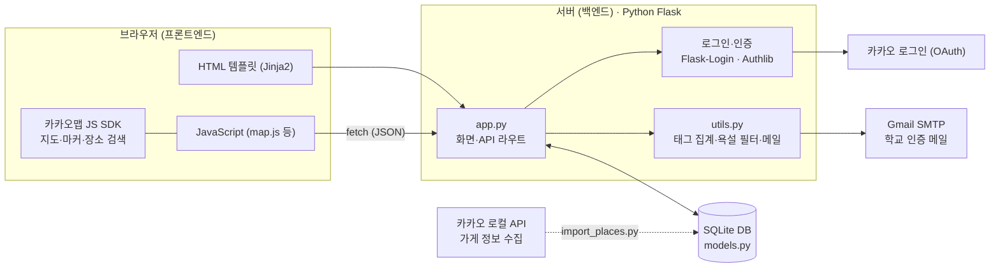
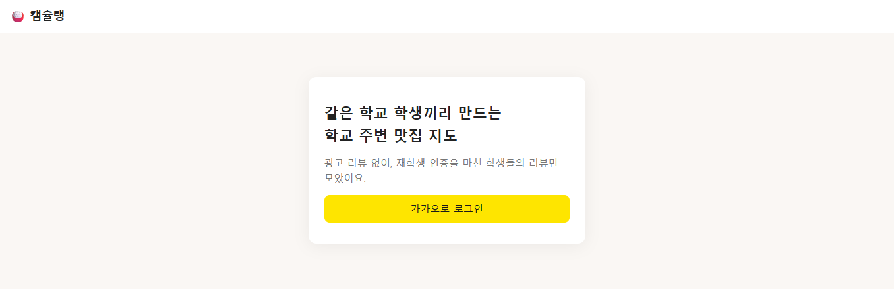
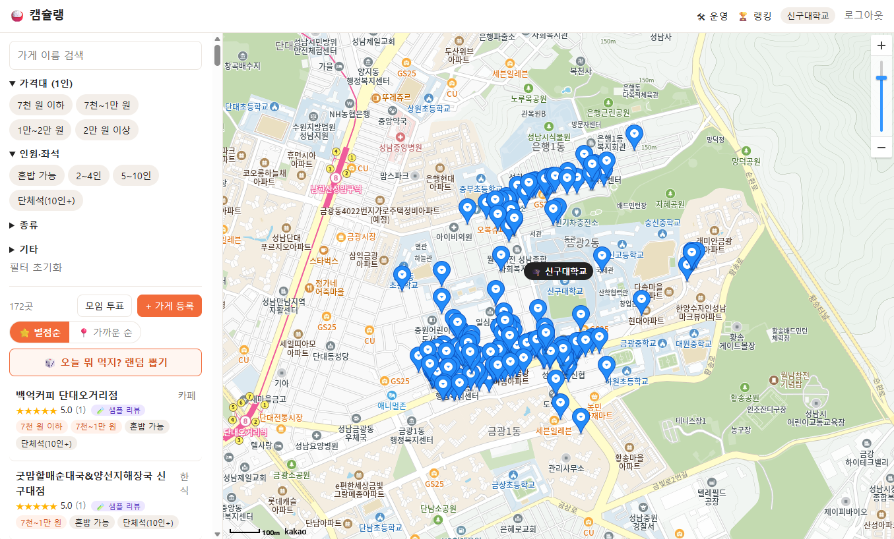
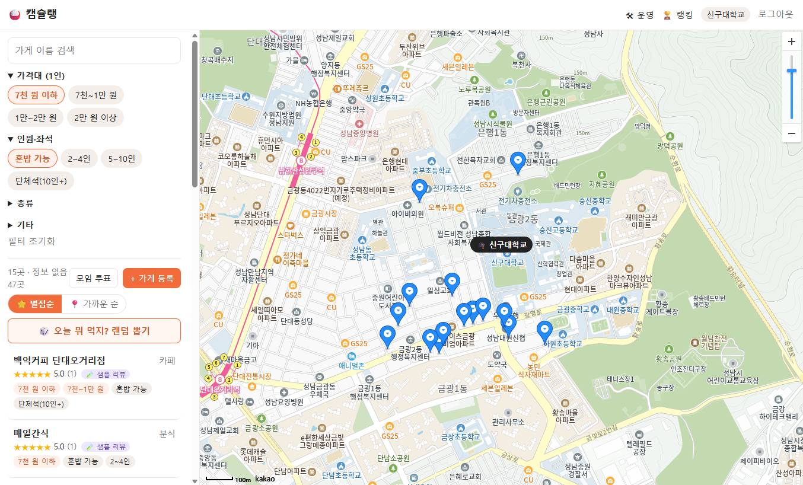
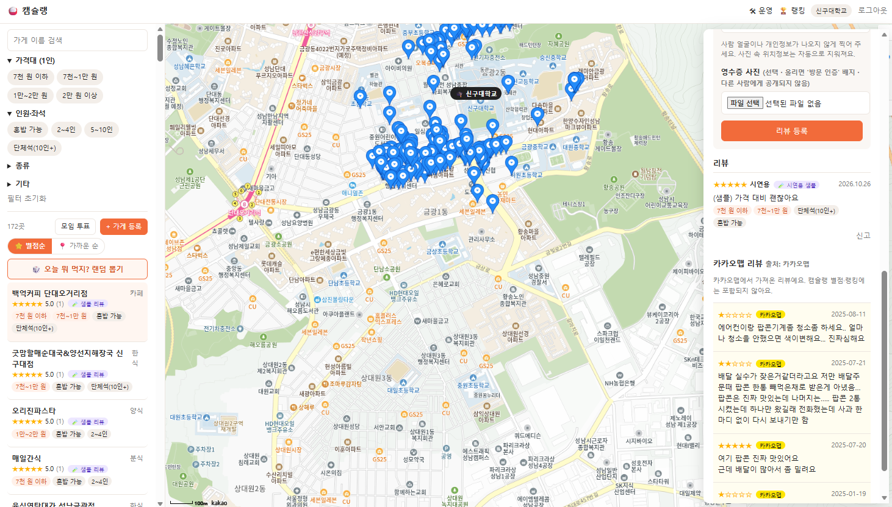
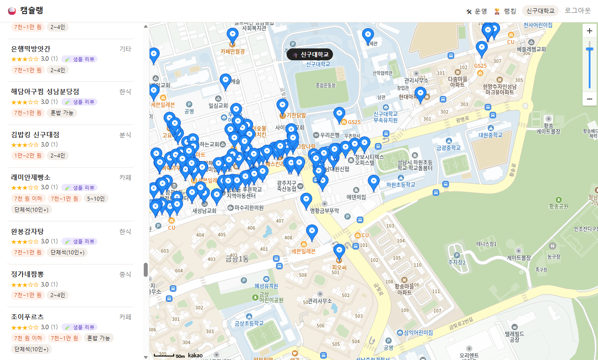
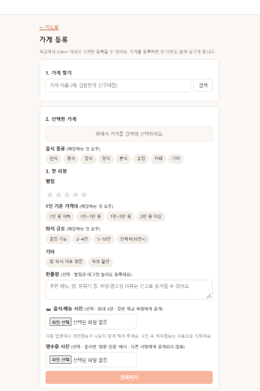
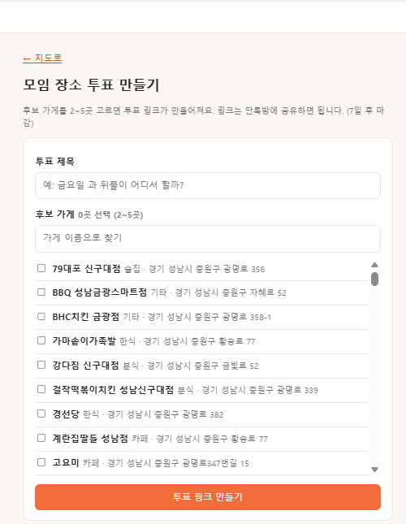
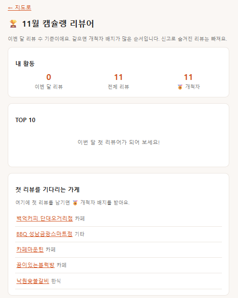
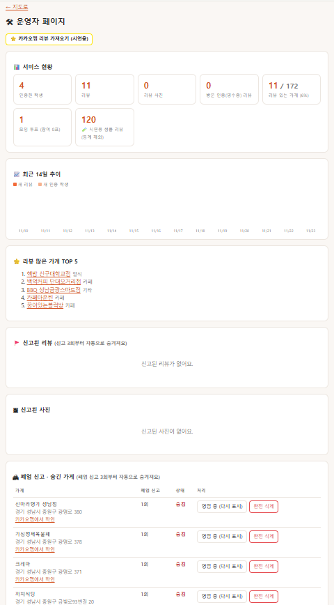

# 🍚 캠슐랭 (Campuslin)

> 같은 학교 학생끼리 만드는 **학교 주변 밥집·술집 지도**
> 광고·체험단 리뷰 없이, **학교 인증을 마친 학생들의 리뷰만** 모읍니다.

| 항목 | 내용 |
|---|---|
| 배포 주소 (Replit) | https://cf1ae03b-ac27-4a05-82a5-139733027ddc-00-3ahgch1z0mhqn.sisko.replit.dev |
| GitHub | https://github.com/2022143018/2022143018-campuslin |
| 대상 학교 | 신구대학교 (설정으로 다른 학교도 가능) |
| 개발 | 2022143018 · AI(Claude)와 함께 개발 |

> 시연용 서버라 **시연할 때만 켜 둡니다.** 꺼져 있으면 주소가 열리지 않을 수 있어요.

---

## 1. 서론: 개발 배경 및 목적

### 1-1. 개발 동기
<!-- ✏️ 직접 경험을 한두 줄 더 넣으면 좋아요 -->
학교 앞에서 밥집이나 술집을 찾을 때 지도 앱 리뷰를 보면 **블로그 체험단·광고성 리뷰**가 많아서 믿기 어렵고,
"혼밥이 되는지", "1인 1만 원 안쪽인지", "단체로 들어갈 자리가 있는지"처럼 **학생에게 정말 필요한 정보**는 찾기 힘들었습니다.
그래서 에브리타임처럼 **학교 인증을 한 학생만** 리뷰를 쓰고, 학생 기준의 **가격대·좌석 필터**로 찾을 수 있는 지도를 만들었습니다.

### 1-2. 유사 서비스 검토

| 서비스 | 장점 | 학생 입장에서 아쉬운 점 | 캠슐랭의 차이 |
|---|---|---|---|
| 카카오맵 · 네이버 지도 | 가게 정보·리뷰가 많음 | 광고·체험단 리뷰가 섞여 있고, 학생 기준(혼밥, 1인 가격대, 단체석) 필터가 없음 | 학교 인증 학생 리뷰만 + 학생 기준 필터 |
| 에브리타임 | 학교 인증으로 신뢰도 높음 | 맛집 정보가 게시판 글로 흩어져 있어 **지도에서 찾기 어려움** | 같은 신뢰 구조를 **지도**로 정리 |
| 배달·예약 앱 | 메뉴·가격 확인 쉬움 | 배달·예약 중심이라 직접 가는 가게 정보는 부족 | 매장 방문 기준 정보(좌석·분위기) |

### 1-3. 대상과 제공 기능
- **대상:** 학교 주변에서 밥집·술집을 찾는 재학생 (1차 대상: 신구대학교)
- **제공 기능**
  1. **학교 인증 기반 리뷰**: 학교 이메일 인증을 마친 학생만 가게 등록·리뷰 작성
  2. **학생 맞춤 필터 지도**: 1인 가격대, 좌석 규모(혼밥·단체석), 종류, 기타 조건으로 지도에서 바로 찾기
  3. **모임 장소 투표**: 후보 가게로 투표 링크를 만들어 단톡방에서 바로 결정
  4. 그 밖에: 오늘 뭐 먹지? 랜덤 뽑기, 가까운 순 정렬, 이달의 리뷰 랭킹, 운영자 페이지

---

## 2. 본론: 서비스 구현 상세

### 2-1. 전체 구조



| 구분 | 사용 기술 | 역할 |
|---|---|---|
| 프론트엔드 | HTML(Jinja2 템플릿), CSS, JavaScript | 화면 구성, 필터·목록·리뷰 작성 화면 |
| 지도 | 카카오맵 JavaScript SDK (services, clusterer) | 지도 표시, 마커·클러스터, 가게 검색 |
| 백엔드 | Python 3, **Flask** | 화면 주소(라우트)와 API 처리 |
| 로그인 | Flask-Login, Authlib (카카오 OAuth) | 카카오 로그인, 자동 로그인 유지 |
| 보안 | Flask-WTF (CSRF), Pillow | 요청 위조 방지, 사진 위치정보(EXIF) 제거 |
| 데이터베이스 | SQLite + Flask-SQLAlchemy | 학교·회원·가게·리뷰·투표 저장 |
| 외부 API | 카카오 로컬 API, Gmail SMTP | 가게 정보 수집, 학교 인증 메일 발송 |
| 실행·배포 | Waitress, **Replit** | 운영용 서버 실행, 웹 배포 |

### 2-2. 폴더 구조 (기능별로 어떤 파일이 담당하는지)

```
campuslin/
├─ app.py              # 서버의 중심: 모든 화면 주소와 API (로그인, 지도 데이터, 리뷰, 투표, 운영자)
├─ models.py           # DB 테이블 정의 (학교, 회원, 가게, 리뷰, 사진, 투표 등)
├─ utils.py            # 공통 기능: 태그 정의, 리뷰 집계, 욕설 필터, 인증 메일 발송
├─ serve.py            # 실제 서비스 실행 파일 (설정 점검 + Waitress 서버)
├─ import_places.py    # 카카오 로컬 API로 학교 주변 가게 자동 등록
├─ sample_reviews.py   # 시연용 샘플 리뷰 넣기/지우기 (🧪 표시)
├─ backup_db.py        # DB·사진 백업
├─ requirements.txt    # 필요한 파이썬 패키지 목록
├─ .env.example        # 설정 예시 (실제 키는 .env / Replit Secrets에만 보관)
├─ templates/          # 화면(HTML)
│   ├─ base.html         # 모든 화면의 공통 틀 (상단 메뉴)
│   ├─ login.html        # 로그인
│   ├─ verify.html       # 학교 이메일 인증
│   ├─ map.html          # 메인 지도 + 목록 + 필터 + 가게 상세
│   ├─ place_new.html    # 가게 등록
│   ├─ vote_new.html     # 모임 투표 만들기
│   ├─ vote.html         # 투표 참여·결과
│   ├─ ranking.html      # 이달의 리뷰 랭킹
│   ├─ admin.html        # 운영자 페이지
│   └─ kakao_import.html # (시연용) 카카오맵 리뷰 가져오기
└─ static/
    ├─ css/style.css     # 디자인
    └─ js/
        ├─ common.js     # 공통 도우미 (API 요청, 글자 안전 처리)
        ├─ map.js        # 지도·마커·필터·정렬·랜덤 뽑기·리뷰 작성
        └─ place_new.js  # 가게 검색·등록 화면 동작
```

**데이터베이스 테이블 (models.py)**

| 테이블 | 저장 내용 |
|---|---|
| School | 학교 이름, 인증 이메일 도메인, 학교 좌표 |
| User | 카카오 로그인 정보, 인증한 학교 이메일 |
| EmailVerification | 인증 코드(암호화 저장), 시도 횟수, 만료 시간(10분) |
| Place | 가게 이름·주소·좌표·종류, 카카오 장소 ID(중복 방지), 숨김 여부 |
| Review / ReviewPhoto | 별점, 한줄평, 가격대·좌석 태그, 사진, 영수증(방문 인증) |
| Report | 리뷰·사진 신고, 폐업 신고 |
| Vote / VoteOption / Ballot | 모임 투표, 후보 가게, 투표 기록 |
| KakaoReview | (시연용) 카카오맵에서 가져온 리뷰 |

### 2-3. 핵심 기능

#### ① 학교 인증 로그인
- **카카오로 로그인** → **학교 이메일(@shingu.ac.kr) 인증 코드** 입력 → 인증된 학생만 서비스 이용
- 인증 코드는 10분 뒤 만료되고, 한 학교 이메일은 한 계정에만 연결됩니다.
- 담당: `app.py`(login, auth_callback, verify), `utils.py`(메일 발송), `templates/login.html`, `verify.html`



#### ② 학생 맞춤 필터 지도
- 학교 주변 가게를 지도 마커로 표시하고, 마커가 많으면 묶어서(클러스터) 보여줍니다.
- **필터:** 1인 가격대(7천 원 이하 ~ 2만 원 이상), 좌석(혼밥·2 ~ 4인·5 ~ 10인·단체석), 종류, 기타(밤 10시 이후 영업, 학생 할인). 여러 개를 동시에 고를 수 있어요.
- 태그는 **리뷰어 과반이 고른 것만** 표시해서 한 사람의 의견에 휘둘리지 않게 했습니다.
- 리뷰가 없는 가게는 "정보 없음"으로 따로 묶어 보여줍니다.
- **별점순 / 가까운 순**(내 위치 기준) 정렬, **오늘 뭐 먹지? 랜덤 뽑기**(현재 필터 조건 안에서 무작위 추천)
- 담당: `templates/map.html`, `static/js/map.js`, `app.py`(/api/places), `utils.py`(aggregate)



*필터 적용 예시: 7천 원 이하 + 혼밥 가능 → 15곳 (리뷰 없는 47곳은 "정보 없음"으로 따로 표시)*



#### ③ 가게 상세 · 10초 리뷰
- 가게를 누르면 사진, 평균 별점, 태그, 리뷰 목록이 나옵니다.
- **10초 리뷰:** 별점과 태그만 눌러도 등록(한줄평·사진은 선택). 1인 1가게 1리뷰.
- 영수증 사진을 올리면 **방문 인증** 배지(영수증은 공개되지 않음), 가게의 첫 리뷰는 **🏅 개척자** 배지
- 욕설 필터, 신고 3회 이상이면 자동 숨김, 사진 위치정보 자동 제거
- 마지막 리뷰가 6개월 이상 지난 가게는 "영업 중인지 확인" 안내, 폐업 신고 기능
- 담당: `static/js/map.js`, `app.py`(/api/places/<id>, /api/places/<id>/reviews), `models.py`(Review, ReviewPhoto)





#### ④ 가게 등록
- 카카오 장소 검색으로 가게를 찾아 등록 (카카오 장소 ID로 **중복 등록 방지**, 학교 3km 이내만 가능)
- 등록하면서 첫 리뷰도 함께 작성
- 초기 데이터는 `import_places.py`로 **카카오 로컬 API**를 이용해 학교 반경 1km 음식점·카페를 자동 등록했습니다 (웹 크롤링이 아닌 공식 API).
- 담당: `templates/place_new.html`, `static/js/place_new.js`, `app.py`(/places/new), `import_places.py`



#### ⑤ 모임 장소 투표
- 후보 가게 2~5곳을 골라 투표 링크를 만들고 단톡방에 공유 → **로그인 없이** 투표, 결과는 5초마다 자동 갱신, 7일 뒤 마감
- 담당: `templates/vote_new.html`, `vote.html`, `app.py`(/votes/new, /v/<slug>)



#### ⑥ 랭킹
- 이번 달 리뷰 수 → 개척자 수 순서로 TOP 10 (이름 일부 가림, 신고로 숨겨진 리뷰·샘플 리뷰 제외)
- 내 활동(이번 달 리뷰, 전체 리뷰, 개척자 수)과 **첫 리뷰를 기다리는 가게** 목록으로 리뷰 작성을 유도
- 담당: `templates/ranking.html`, `app.py`(ranking)



#### ⑦ 운영자 페이지
- `.env`의 `ADMIN_EMAILS`에 등록된 계정만 접근 (다른 사람에게는 없는 페이지처럼 보임)
- 서비스 현황(인증 학생 수, 리뷰 수, 리뷰 있는 가게 비율), 최근 14일 추이, 리뷰 많은 가게 TOP 5
- 신고된 리뷰·사진 복구/삭제, 폐업 신고 가게 다시 표시·숨김·완전 삭제
- 담당: `templates/admin.html`, `app.py`(admin, admin_review, admin_photo, admin_place)



### 2-4. 시연 데이터에 대해 (중요)
- 이 서비스는 **과제 제출용**으로 만들어, 실제 학생들의 리뷰를 충분히 받을 수 없었습니다.
- 그래서 화면이 비어 보이지 않도록 아래 두 가지를 **구분해서 표시**했습니다.
  - **🧪 시연용 샘플 리뷰:** `sample_reviews.py`로 넣은 예시 리뷰. 화면에 "샘플 리뷰"로 표시되고 랭킹·개척자·통계에서 제외됩니다.
  - **카카오맵 리뷰 (출처: 카카오맵):** 운영자가 카카오맵 가게 페이지를 직접 열고 버튼을 눌러 가게당 최대 5개를 옮긴 리뷰. 캠슐랭 리뷰와 분리해 출처와 함께 표시하고, 별점·랭킹에는 넣지 않았습니다. 리뷰가 없거나 글이 없는(별점만 있는) 가게는 가져오지 못했습니다.
- 실제로 운영한다면 두 기능을 모두 끄고 **학교 인증 학생 리뷰만** 쓰는 것이 원래 목표입니다.

### 2-5. 실행 · 배포 방법
1. `pip install -r requirements.txt`
2. `.env.example`을 참고해 설정값을 `.env`(내 PC) 또는 **Replit Secrets**에 입력 (키는 GitHub에 올리지 않음)
3. 개발: `python app.py` / 서비스: `python serve.py`
4. 카카오 개발자 콘솔에 배포 주소 등록 (JavaScript SDK 도메인, 로그인 Redirect URI)

**배포 과정:** 처음에는 내 PC에서 ngrok 터널로 공개했고, 이후 Replit으로 옮겨 배포했습니다. Replit이 자동으로 만든 `DATABASE_URL` 설정 때문에 PostgreSQL로 접속하려다 실행이 멈추는 문제가 있어, 캠슐랭 전용 설정 이름(`CAMPUSLIN_DB_URL`)을 쓰도록 바꿔 해결했습니다.

---

## 3. 결론

### 3-1. 서비스의 한계
- **실제 사용자 리뷰 부족:** 과제 기간 안에 학생 리뷰를 모으지 못해 샘플 리뷰와 카카오맵 리뷰로 시연했습니다.
- **한 학교만 설정:** 지금은 신구대학교 기준이며, 여러 학교를 동시에 운영하는 기능은 없습니다.
- **배포 환경:** Replit은 시연할 때만 켜 두어 항상 접속되지는 않고, SQLite 파일 DB라 접속자가 많아지면 한계가 있습니다.
- **학교 인증 방식:** 학교 이메일이 있는 학생만 가입할 수 있습니다.

### 3-2. 향후 보완 사항
- 학생 리뷰가 쌓이면 시연용 샘플 리뷰·카카오맵 리뷰 기능 끄기
- PostgreSQL 같은 서버형 DB와 상시 배포로 전환
- 여러 학교 지원 (학교별 지도·랭킹)
- 메뉴판·가격 정보, 학생 할인 정보 등록 기능

### 3-3. 사용자 피드백
<!-- ✏️ 직접 써 주세요: 친구에게 보여줬을 때의 반응이나, 직접 써 보며 느낀 점 -->
- (예: 직접 사용해 보니 ○○ 필터가 편했고, ○○은 불편했다)
- (예: 친구에게 보여줬을 때 ○○ 기능에 대한 반응)

### 3-4. AI와 함께 개발하며
<!-- ✏️ 본인 경험을 직접 적어 주세요 -->
이 서비스는 AI(Claude)와 대화하며 개발했습니다. 기획(문제·기능 정의)과 테스트·배포 확인은 직접 하고, 코드 작성은 AI의 도움을 받았습니다.
위의 **폴더 구조와 기능별 담당 파일** 표를 정리하며 각 기능이 어디서 처리되는지 파악했습니다.
